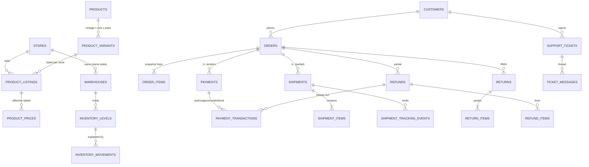

# E-commerce Customer Database (Phase 2, part A)

The relational source of truth behind the Wines AI Platform Agent: customers, catalog, pricing, inventory, orders, payments, fulfillment, returns, refunds, support, and audit. It covers a two-state (NJ + NY) licensed wine and spirits retailer and is designed to scale to enterprise volume.

**Status:** this SQLite build is the reference schema and the source of the fictional seed. Phase 2B (the FastAPI Tool APIs and the LangGraph agent, see the [root README](../README.md)) runs on PostgreSQL: `alembic upgrade head` creates the schema and `scripts/load_seed.py` copies this seed into it. The AI agent reaches the data **only through authenticated API tools** (contract: [`_KB/00_system/tool-reference.md`](../_KB/00_system/tool-reference.md)), never by SQL.

## Quick start

```bash
python3 scripts/initialize_db.py --force          # build _DB/ecommerce.db and verify it
python3 scripts/initialize_db.py --force --demo   # ...and print the 20 sample support queries
python3 scripts/initialize_db.py --verify-only    # re-check an existing database
python3 -m unittest discover -s tests -v          # 36 constraint tests (all should pass)
sqlite3 _DB/ecommerce.db                     # explore (run PRAGMA foreign_keys=ON; first)
```

Requirements: Python 3.9+ and SQLite 3.38+ (standard library only). The build writes to a temp file and replaces `ecommerce.db` only if every check passes.

## Files

| File | What it is |
|---|---|
| `schema.sql` | 64 STRICT tables, 195 indexes (135 explicit, incl. every FK), 36 integrity triggers, 9 read views |
| `seed_data.sql` | Fictional data: 12 customers, 39 SKUs, 2 stores and 5 warehouses, 20 order scenarios (≈1,550 rows) |
| `sample_queries.sql` | 20 customer-support queries, each mapped to a KB tool (`-- @query Qnn` blocks) |
| `ecommerce.db` | Built database (regenerate it; don't edit it by hand) |
| `../scripts/initialize_db.py` | Build, verify (integrity, FKs, FK indexes, 21 business invariants), demo |
| `../tests/test_database.py` | Proves the database itself rejects bad data |

## Domain map



| Domain | Tables |
|---|---|
| Organization | `stores`, `store_hours`, `store_hours_exceptions`, `warehouses`, `staff_users` |
| Customers | `customers`, `age_verifications`, `customer_addresses`, `customer_payment_methods` (tokens only), `communication_preferences`, `customer_taste_profiles` |
| Catalog (wine-aware) | `regions` (country → appellation tree), `brands`, `grape_varieties`, `wine_styles`, `categories`, `products` (six KB taste axes), `product_categories`, `product_grapes` (blend %), `product_variants` (SKU), `variant_certifications` (with evidence), `variant_nutrition`, `product_accolades` |
| Pricing | `product_listings` (per-store assortment and jurisdiction), `product_prices` (regular/sale history), `product_costs` (below-cost floor), `tax_rates`, `fulfillment_rates`, `promotions`, `promotion_tiers`, `promotion_targets`, `price_match_requests` |
| Inventory | `inventory_levels`, `inventory_movements` (ledger), `inventory_reservations`, `back_in_stock_subscriptions` |
| Cart and orders | `carts`, `cart_items`, `orders`, `order_addresses`, `order_items`, `order_item_substitutions`, `order_discounts`, `order_discount_allocations`, `order_status_history` |
| Payments | `gift_cards`, `payments`, `payment_transactions` |
| Fulfillment | `shipments`, `shipment_items`, `shipment_tracking_events` |
| Returns and refunds | `returns`, `return_items`, `return_evidence`, `refunds`, `refund_items` |
| Money ledgers | `store_credit_transactions`, `gift_card_transactions`, `loyalty_accounts`, `loyalty_rewards`, `loyalty_point_transactions` |
| Support and audit | `support_tickets`, `ticket_messages`, `audit_logs` |

Views: `v_region_paths`, `v_product_catalog`, `v_current_prices`, `v_inventory_availability` (maps stock to the KB `stock_status` vocabulary and `qty_bucket`), `v_customer_age_verification`, `v_order_item_fulfillment`, `v_payment_balances`, `v_order_financials`, `v_customer_balances`.

## Key design decisions

**Conventions**
- Money is `INTEGER` cents (`_cents`). Discounts are in basis points (`_bps`, 1000 = 10%). Tax rates are in parts per million (`_ppm`, 66250 = 6.625%), because NJ's 6.625% doesn't fit basis points. Tax is rounded half-up per line.
- Surrogate `INTEGER` keys are internal. Customers and the agent only ever see public business keys: `customer_number`, `order_number`, `rma_number`, `refund_number`, `shipment_number`, `ticket_number`, `sku`. That keeps IDs non-enumerable through the API.
- Timestamps are ISO-8601 UTC text. Enumerations are `TEXT` + `CHECK`, and their values match the KB (order lifecycle, `stock_status`, return `reason_code`, escalation `reason_code`, taste axes, certification tags).
- `STRICT` tables stop SQLite's type affinity from storing `'12.99'` in a cents column.

**Real-world scenarios**

| Scenario | How it is modeled |
|---|---|
| Many orders per customer, many products per order | `orders` → `order_items` (unique `line_number`) |
| Historical snapshots | `order_items` freezes SKU, name, brand, vintage, size, regular and charged price, discount, tax and flags. A trigger makes those columns immutable; `price_id` records which price row applied (A-40 price lock). `order_addresses` snapshots addresses. |
| Partial shipments | `shipments` 1:N per order; `shipment_items` holds quantities per line. Each shipment can be a separate capture (A-29: authorize at order, capture at fulfillment). |
| Multiple payment transactions | `payments` (one per tender, so split gift-card/store-credit + card works) → `payment_transactions` ledger: authorization, captures, void, refunds, chargeback, each with an idempotency key. |
| Partial cancellations | `order_items.quantity_cancelled` plus a partial **void** of the remaining authorization (WA-100114). |
| Partial returns | `return_items` per line and quantity; reasons follow `create_return_request`. Restocking fees apply only to change-of-mind returns (A-34). |
| Partial refunds | `refunds` (the business decision, with an items/tax/shipping/tip/restocking breakdown) → `refund_items` (per line; `quantity` 0 = price-only adjustment) → money in `payment_transactions` or `store_credit_transactions`. |
| Discounts | `order_discounts` allocated to lines through `order_discount_allocations`, so a partial refund returns a line "net of allocated discounts". |
| Wine-specific | Vintage, NV and size as SKU dimensions; `is_vintage_specific` (A-23); collectible/as-is (A-33); 750 ml equivalents for mixed cases (`bottle_equiv_milli`, A-50); allocations; pre-arrivals; per-vintage certifications with evidence (ORG-R1). |

**Integrity is enforced in the database, not only in code.** There are five layers:
1. **CHECK**: arithmetic (`line_total = subtotal − discount + tax`, `grand_total = …`), enums, 21+ at signup (`date_of_birth <= date(created_at,'-21 years')`), NJ/NY-only shipping, no PO box/school/dorm delivery, no handoff without an ID check, AI-agent refunds ≤ $150 unless flagged for human approval (A-60), AI goodwill ≤ $15 (A-61).
2. **Composite foreign keys** make cross-entity consistency declarative. A return line must belong to the return's order. A shipment's warehouse must belong to the order's store, so stock never crosses state lines (A-01). A saved card must belong to the paying customer.
3. **Triggers** cover cross-row rules: no over-shipping, over-returning or over-refunding (line, payment and order level); captures ≤ authorization; non-negative ledger balances; append-only audit logs and ledgers; no overlapping price windows; shipping-address state = store state; at most 10 addresses (A-75).
4. **Build-time invariants** in `initialize_db.py`: totals, allocations, ledger ↔ balance reconciliation, reservations, status history, and A-04/A-05/A-06 compliance.
5. **Tests**: 36 cases prove each rule rejects bad data.

## Seed scenarios (fictional data, reference date 2026-11-19)

| Order | Scenario |
|---|---|
| WA-100101 | Completed NJ delivery, 6-bottle mixed-case discount, tip |
| WA-100102 | Broken Champagne → auto-approved claim → partial refund to card |
| WA-100103 | 12-bottle case (15%) **split shipment**: 9 delivered, 3 backordered in transit; two captures |
| WA-100104 | Late delivery + wrong bottle → 1-of-3 refund, customer keeps the wrong bottle, $10 goodwill credit |
| WA-100105 | NJ pickup of non-alcoholic wine with an alternate pickup person; stock reserved |
| WA-100106 | **Split tender** (gift card + Amex); corked bottle → refund as store credit |
| WA-100107 | Gift shipment; UPS delivery exception (no adult to sign) |
| WA-100108 | Suspected account takeover: order on fraud hold, account locked, P1 ticket |
| WA-100109 | First order waiting on ID verification; WELCOME10 applied |
| WA-100110 | Two failed deliveries → returned to store → cancelled → refund minus delivery fee |
| WA-100111 | NJ change-of-mind return of 2 of 3 bottles, 15% restocking fee, loyalty reversal |
| WA-100112 | NY pickup; human-approved **price match** refund |
| WA-100113 | Cancelled before picking → authorization voided |
| WA-100114 | Vintage substitution declined → 1 unit cancelled → partial capture + partial void |
| WA-100115 | Pre-arrival vintage Champagne, paid in full |
| WA-100116 | Both bottles broken, $218.57 > agent limit → refund `pending_approval`, P2 finance ticket |
| WA-100117 | Pickup paid partly with a loyalty reward |
| WA-100118 | Chargeback open → refund guard (RF-R5) |
| WA-100119 | Weather hold on a packed shipment |
| WA-100120 | Out for delivery now; store credit + card |

Inventory covers every KB `stock_status` except `waitlist`, which the view can derive but the seed doesn't use. Tickets include an unauthenticated visitor (`kb_gap`), a privacy request and a special order.

## KB tool → data map (for phase 2B)

| Tool(s) | Reads/writes |
|---|---|
| `search_products`, `get_product_details`, `get_similar_products` | `v_product_catalog`, `variant_certifications`, `variant_nutrition`, `product_accolades`, `v_current_prices`, `v_inventory_availability` |
| `check_inventory`, `subscribe_back_in_stock` | `v_inventory_availability`, `back_in_stock_subscriptions` |
| `get_price`, `get_active_promotions`, `validate_promo_code`, `calculate_order_totals` | `v_current_prices`, `product_costs` (floor, internal only), `promotions*`, `tax_rates`, `fulfillment_rates` |
| `get_cart` … `remove_from_cart` | `carts`, `cart_items` |
| `list_orders`, `get_order`, `get_order_status`, `track_shipment` | `orders`, `order_items`, `order_status_history`, `v_order_item_fulfillment`, `shipments`, `shipment_tracking_events` |
| `cancel_order`, `modify_order`, `respond_to_substitution`, `reschedule_delivery` | `orders`, `order_items.quantity_cancelled`, `order_item_substitutions`, `inventory_reservations`, `payment_transactions` (void) |
| `create_return_request`, `request_evidence_upload`, `get_return_status` | `returns`, `return_items`, `return_evidence` |
| `issue_refund`, `issue_store_credit` | `refunds`, `refund_items`, `payment_transactions`, `store_credit_transactions` (authority enforced by CHECK) |
| `get_customer_profile`, `manage_address`, `remove_payment_method`, `get_age_verification_status`, `update_communication_preferences`, `lock_account` | `customers`, `customer_addresses`, `customer_payment_methods`, `v_customer_age_verification`, `communication_preferences` |
| `get_loyalty_account`, `redeem_reward`, `adjust_loyalty_points`, `get_gift_card_balance` | `loyalty_*`, `gift_cards`, `gift_card_transactions` |
| `submit_price_match_request`, `create_support_ticket`, `escalate_to_human`, `get_store_info` | `price_match_requests`, `support_tickets`, `ticket_messages`, `stores`, `store_hours*` |
| every state-changing tool | one `audit_logs` row in the same transaction |

## Security notes for the API phase

- **Grant least privilege per role.** The agent's service role gets views and narrowly scoped write procedures, not raw tables. `product_costs`, exact `qty_on_hand`, staff emails and internal ticket notes are never exposed to it.
- **Mask contact data on read:** `o***@example.com`, `***-***-0111` (see Q01).
- **No card numbers, CVV or ID images are ever stored.** Only processor tokens, last 4 digits and object-store references.
- **Use idempotency keys** on refunds and payment transactions (unique constraints already exist). Add a request-level idempotency table in the API phase.
- **Make `audit_logs` insert-only** for the app role in PostgreSQL (`REVOKE UPDATE, DELETE`). Consider hash-chaining rows for tamper evidence.
- **Anonymize, don't delete.** Customers are never hard-deleted; privacy deletion anonymizes PII (status `anonymized`) because order, tax and age records must be retained (A-73).

## Migrating to PostgreSQL

| SQLite here | PostgreSQL |
|---|---|
| `INTEGER PRIMARY KEY` | `BIGINT GENERATED ALWAYS AS IDENTITY` |
| `) STRICT;` | drop the keyword |
| `TEXT` ISO timestamps / dates | `TIMESTAMPTZ` / `DATE` |
| `INTEGER` 0/1 + CHECK | `BOOLEAN` |
| `TEXT` + `json_valid()` CHECK | `JSONB` |
| `REAL` (ABV, nutrition) | `NUMERIC(5,2)` |
| `TEXT` + `CHECK (x IN (…))` | keep as is, or `CREATE TYPE … AS ENUM` |
| `strftime('…','now')` defaults and views | `now()` |
| `date(created_at,'-21 years')` | `created_at::date - INTERVAL '21 years'` |
| `GENERATED ALWAYS AS (…) VIRTUAL` | `… STORED` (VIRTUAL needs PG 18+) |
| Triggers with `RAISE(ABORT, …)` | PL/pgSQL trigger functions with `RAISE EXCEPTION` |
| `product_prices` no-overlap trigger | `EXCLUDE USING gist (store_id WITH =, variant_id WITH =, price_type WITH =, tstzrange(starts_at, ends_at) WITH &&)` |
| Expression/partial indexes, `UPDATE … FROM`, window functions, recursive CTE views | same syntax works |
| `lower(email)` unique index | same, or a `CITEXT` column |

Also: create tables in file order (every FK target is defined first; the only self-references are `regions`, `categories`, `orders` and `payment_transactions`). Partition `audit_logs`, `inventory_movements` and `shipment_tracking_events` by month once they grow.

## Contract decisions (confirmed 2026-11-19)

1. **`partially_fulfilled`** is an order status for split shipments (now in `_KB/11_orders-delivery-pickup/order-status-lifecycle.md` v1.1.0).
2. KB side states **`refunded` / `partially_refunded`** live in `orders.payment_status`, not `orders.status`. That keeps the fulfillment and financial dimensions separate, as Shopify and Medusa do. `get_order_status` returns both (`_KB/00_system/tool-reference.md` v1.1.0).
3. The KB tool contract uses **decimal-string money**. The API converts to and from integer cents at the boundary.
Open items (not yet decided):

4. Authentication (passwords, sessions, OTP challenges) belongs to the identity provider and API layer, so it is out of scope here. `customers.status = 'locked'` is the lock flag.
5. `updated_at` is set by the API layer (no SQLite triggers). Add a generic `updated_at` trigger in PostgreSQL.
6. Tax rates, fees and thresholds in the seed are illustrative and follow KB assumptions A-10…A-61. Change them in the KB register first.

## Research references

These patterns were adapted from public documentation, not copied:
- Medusa: [Order returns](https://docs.medusajs.com/resources/commerce-modules/order/return) and [payments, captures and refunds](https://docs.medusajs.com/resources/commerce-modules/payment/payment). The return/refund split and transactions as records.
- Stripe: [Refunds](https://docs.stripe.com/refunds) and [multicapture](https://docs.stripe.com/terminal/features/multicapture). Authorize/capture/refund in smallest currency units; partial captures and refunds.
- Shopify: [ReturnLineItem](https://shopify.dev/docs/api/admin-graphql/latest/objects/ReturnLineItem). Returns reference fulfilled quantities; partial fulfillment splits work.
- commercetools: [Carts and Orders overview](https://docs.commercetools.com/api/carts-orders-overview). Line items are snapshots of the variant and price.
- Saleor: [Order line](https://docs.saleor.io/api-reference/orders/objects/order-line). Product name, SKU and undiscounted vs discounted unit price stored on the line.
- SQLite: [STRICT tables](https://sqlite.org/stricttables.html).
- Inventory: [stock states](https://docs.sku.io/guides/inventory/stock-states) and the [ledger + balance pattern](https://www.cleverence.com/articles/for-business/inventory-control-database-schema-4721/).
- Wine master data: GS1 attributes such as [vintage](https://gdsn.gs1-germany.de/BMSattribute?id=357) and [grape variety](https://gdsn.gs1-germany.de/BMSattribute?id=1283).
- Audit logging: [append-only audit trail practices](https://techinterview.org/system-design-audit-log/).
