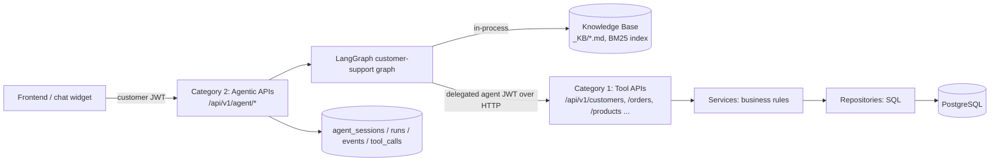
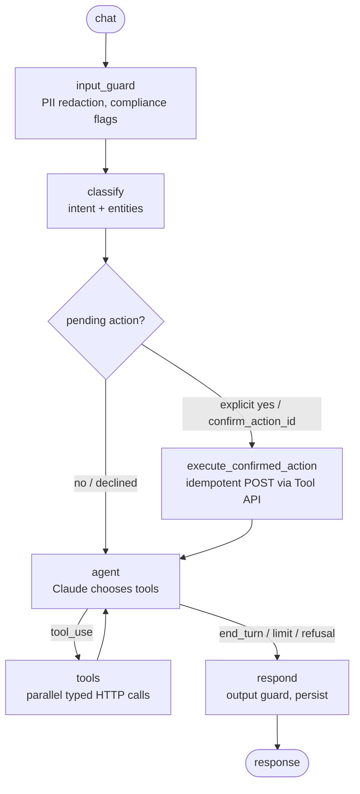

# Wines AI Platform Agent: API Architecture and Endpoint Specification

Status: implemented (phase 2B). Contract source: [`_KB/00_system/tool-reference.md`](../_KB/00_system/tool-reference.md). Data source: [`_DB/`](../_DB/README.md).

## 1. The two API categories



| | Category 1: Tool APIs | Category 2: Agentic APIs |
|---|---|---|
| Purpose | Business data and actions, one responsibility per endpoint | Accept a question, run the agent, expose what it did |
| Callers | The agent (as tools), and any authorized UI or back office | The frontend only |
| Auth | `customer`, `agent` (delegated, on behalf of one customer) or `staff` JWT | `customer` or `staff` JWT |
| State | PostgreSQL business tables | Agent session, run, event and tool-call tables |
| Talks to the DB | Yes, through repositories only | Only its own observability tables, through its own repository. **Never business tables.** |

### How they communicate

1. The frontend sends `POST /api/v1/agent/chat` with the customer's JWT.
2. The chat service checks that the token's customer matches `customer_id`. It then mints a **delegated agent token**: `role=agent`, `sub=<customer>`, `sid=<session>`, `run=<run>`, 5-minute TTL, a fixed scope list.
3. Every tool the LLM chooses is a typed wrapper around one HTTP call to a Tool API, made with that delegated token through `ToolApiClient`. The client applies a timeout, retries (GETs and idempotent POSTs only), a circuit breaker and a request-ID header.
4. The Tool API authenticates the token, enforces **ownership** (an agent token for C-100001 gets `404` for C-100002's orders, which also prevents enumeration), applies business rules and writes an audit row.
5. **The customer ID is never an LLM parameter.** Tool wrappers bind it from the session, so a prompt injection can't make the agent read another customer's data.
6. By default (`TOOL_API_BASE_URL` empty), the HTTP calls go through an in-process ASGI transport. The full HTTP stack (auth, validation, rate limits, audit) still runs, without a network hop. Set `TOOL_API_BASE_URL` to split the two categories into separately scaled deployments.

## 2. Conventions (both categories)

| Topic | Rule |
|---|---|
| Base path | `/api/v1` |
| Identifiers | Public business keys only: `C-100001`, `WA-100101`, `RMA-300001`, `RF-400001`, `TKT-500001`, SKUs. Surrogate integer keys never leave the service. |
| Money | Decimal strings in USD (`"52.18"`), converted from integer cents at the boundary. |
| Time | ISO-8601 UTC (`2026-11-19T18:00:00Z`). |
| Pagination | `page` (≥1), `page_size` (1–100, default 20). The response is `{items, page, page_size, total, has_more}`. |
| Sorting | `sort=-placed_at` (a `-` prefix means descending). Each list has a whitelist of sort fields. |
| Errors | `{"error": {"code", "message", "retryable", "request_id", "details"}}`. Internal exceptions are never echoed. |
| Correlation | `X-Request-ID` is accepted, or generated, then echoed and logged on every line. Tool calls forward it. |
| Writes | `POST` only, with an `Idempotency-Key` header (required) and `"confirmed_by_customer": true` in the body. Reusing a key with a different body returns `422 IDEMPOTENCY_KEY_REUSED`. Replays return the stored response with `Idempotent-Replayed: true`. |
| Rate limits | Per principal (or per IP when anonymous). Tool APIs default to 240/min; chat defaults to 30/min. A `429` carries `Retry-After`. |
| Audit | Every write, plus reads of payment and invoice data, inserts an `audit_logs` row in the same transaction. |

### Status codes

| Code | When |
|---|---|
| 200 / 201 / 202 | Read / created / accepted but waiting for human approval (refund above the agent's limit) |
| 400 | Malformed header (for example a bad `Idempotency-Key`) |
| 401 | Missing, expired or invalid token |
| 403 | Authenticated but the role is not allowed (for example, a customer calling a staff-only endpoint) |
| 404 | The resource does not exist **or is not yours** (so you can't tell which) |
| 409 | Idempotent request still in progress; state conflict |
| 422 | Schema validation failed (`VALIDATION_ERROR`) or a business rule blocked the action (`REFUND_NOT_ELIGIBLE`, `ORDER_NOT_CANCELLABLE`, `CONFIRMATION_REQUIRED` ...) |
| 429 | Rate limited (`retryable: true`) |
| 503 | A dependency is down or the circuit is open (`retryable: true`) |

## 3. Category 1: Tool APIs

The **Tool** column gives the agent tool name. Tool names follow `_KB/00_system/tool-reference.md` where the KB defines one.

### A. Customer

| Method | Path | Tool | Responsibility | Key response fields |
|---|---|---|---|---|
| GET | `/customers/{customer_id}` | `get_customer_profile` | Profile with masked contact data | `customer_id, first_name, last_name, email_masked, phone_masked, status, home_store, member_since, age_verification_status` |
| GET | `/customers/{customer_id}/orders` | `list_customer_orders` | Order summaries. Filters: `status`, `fulfillment_type`, `placed_from`, `placed_to`; sort: `placed_at`, `grand_total` | paginated `OrderSummary` |
| GET | `/customers/{customer_id}/addresses` | `get_customer_addresses` | Saved, non-deleted addresses with a restricted-destination flag. The street is masked for agent tokens. | `items[]` |
| GET | `/customers/{customer_id}/account` | `get_account_summary` | Loyalty points, tier and rewards; store-credit balance; saved cards (brand + last 4) | `loyalty{}, store_credit_balance, payment_methods[]` |
| GET | `/customers/{customer_id}/tickets` | `list_support_tickets` | The customer's support tickets (paginated) | `TicketSummary[]` |

### B. Orders

| Method | Path | Tool | Responsibility |
|---|---|---|---|
| GET | `/orders/{order_id}` | `get_order` | Full order: lines, totals, addresses (masked for agents), fulfillment, discounts, shipments summary |
| GET | `/orders/{order_id}/status` | `get_order_status` | `status`, `payment_status`, hold reason (as a category), ETA window, per-shipment status |
| GET | `/orders/{order_id}/tracking` | `get_order_tracking` | Shipments with carrier, tracking URL, attempts, weather hold and tracking events (raw carrier payloads are never returned) |
| GET | `/orders/{order_id}/items` | `get_order_items` | Lines with ordered, cancelled, shipped, delivered, returned and refunded quantities |
| GET | `/orders/{order_id}/payment` | `get_order_payment` | Tenders (card brand + last 4 only), authorized, captured, refunded and voided amounts, open chargeback flag. **Audited.** |
| GET | `/orders/{order_id}/history` | `get_order_history` | Status timeline. Staff codes and internal service names are reduced to an actor type. |
| GET | `/orders/{order_id}/invoice` | `get_invoice` | Invoice/receipt view: seller of record, lines, discounts, tax, fees, tenders, refunds. **Audited.** |

### C. Refunds and returns

| Method | Path | Tool | Responsibility |
|---|---|---|---|
| GET | `/orders/{order_id}/refund-eligibility?reason_code=` | `check_refund_eligibility` | Policy engine decision. **Read-only.** |
| GET | `/orders/{order_id}/return-eligibility?reason_code=` | `check_return_eligibility` | Per-line returnable quantities and windows. **Read-only.** |
| GET | `/orders/{order_id}/refunds` | `get_order_refunds` | Refund records with status, method, breakdown and `customer_facing_reason` |
| GET | `/orders/{order_id}/returns` | `get_order_returns` | RMAs with items, eligibility, remedy and status |
| GET | `/returns/{rma_number}` | `get_return_status` | One RMA |
| POST | `/orders/{order_id}/refunds` | `request_refund` ⚠ | Initiate a refund. Re-runs eligibility server-side and **computes the amount itself** (the client never sends an amount). An agent above $150 (A-60), a claim without evidence, or a second claim within 60 days returns `202` with `status=pending_approval` and opens a P2 ticket. |
| POST | `/orders/{order_id}/returns` | `create_return_request` ⚠ | Create an RMA. Eligibility is `auto_approved`, `needs_review` (evidence required) or `422`. |
| POST | `/returns/{rma_number}/evidence-upload-link` | `request_evidence_upload` | Short-lived upload link (no file goes through chat; RTN-R6) |

**Eligibility response** (both eligibility endpoints):

```json
{
  "order_id": "WA-100114",
  "eligible": true,
  "decision": "eligible",                     // eligible | ineligible | requires_review | cancel_instead
  "reason_code": "corked_or_flawed",
  "reasons": [{"code": "WITHIN_WINDOW", "message": "...", "policy_ref": "A-32"}],
  "window_ends_at": "2026-12-14T21:10:00Z",
  "max_refundable_amount": "56.40",
  "eligible_items": [{"line_number": 1, "sku": "...", "refundable_quantity": 2, "refundable_amount": "56.40"}],
  "agent_can_issue": true,
  "requires_human_approval": false,
  "approval_reasons": [],
  "reason_options": [{"reason_code": "wrong_item", "eligible": true, "window_ends_at": "..."}],
  "next_steps": ["..."],
  "policy_refs": ["A-32", "RTN-R1", "RF-R3"]
}
```

### D. Additional business APIs

| Method | Path | Tool | Responsibility |
|---|---|---|---|
| GET | `/products` | `search_products` | Catalog search (wine-aware): `q`, `product_type`, `color`, `wine_type`, `sweetness`, `body`, `country`, `region`, `grape`, `certification`, `price_min/max`, `is_non_alcoholic`, `location` (NJ/NY), `in_stock_only`; sort: `price`, `name`, `vintage` |
| GET | `/products/{sku}` | `get_product_details` | Wine information: taste axes, grapes, region path, ABV, nutrition (with source), certifications (with evidence), accolades, final-sale, vintage-specific and per-store price and availability. Never returns cost or exact stock. |
| GET | `/products/{sku}/availability?location=` | `check_inventory` | `stock_status`, `qty_bucket`, `sellable_in_jurisdiction`, `allocation_limit`, `next_arrival_estimate` |
| GET | `/shipping/estimate?postal_code=&bottles=&subtotal=` | `get_delivery_estimate` | Fulfilling store (A-01), pickup, local delivery (zone, fee, minimum, free threshold) and carrier shipping (fee, business days); declines out-of-state ZIPs (A-02) |
| GET | `/orders/{order_id}/cancellation-eligibility` | `check_cancellation_eligibility` | A-21 / A-25 decision with refund preview |
| POST | `/orders/{order_id}/cancellation` | `cancel_order` ⚠ | Cancel the order: void open authorizations, refund captured money, release reservations, write a status-history row, audit |
| GET | `/stores` · `/stores/{store_code}` | `get_store_info` | Address, phone, weekly hours, upcoming holiday exceptions |
| POST | `/support/tickets` | `create_support_ticket` | Ticket with category, priority, reason code (escalation matrix), SLA due time (A-63). Idempotent. |
| GET | `/support/tickets/{ticket_number}` | `get_support_ticket` | Ticket with **public** messages only (internal notes are never returned) |
| POST | `/auth/dev-token` | n/a | **Local/dev only.** Issues a customer or staff JWT. In production the identity provider issues tokens. |

⚠ = state-changing. The agent cannot call these directly: see §5.

## 4. Category 2: Agentic APIs

| Method | Path | Responsibility |
|---|---|---|
| POST | `/agent/chat` | Validate the request, resolve the customer and session, run the LangGraph workflow, return the answer and metadata |
| GET | `/agent/sessions/{session_id}` | Session info: customer, status, message and run counts, pending action (summary only), timestamps |
| GET | `/agent/sessions/{session_id}/messages` | Conversation history, paginated (stored PII-redacted) |
| GET | `/agent/sessions/{session_id}/traces` | Runs in this session, each with its ordered events |
| GET | `/agent/runs/{run_id}` | Run status and metadata: intent, model, duration, token usage, error |
| GET | `/agent/runs/{run_id}/steps` | Ordered structured events |
| GET | `/agent/runs/{run_id}/tools` | Tool invocations: name, category, HTTP method and path, status code, outcome, error code, duration, attempts, redacted arguments, response summary |
| GET | `/agent/health` | Database, knowledge base index, LLM configuration, tool API reachability, circuit-breaker state |

**Chat request / response**

```json
// POST /api/v1/agent/chat     Authorization: Bearer <customer JWT>
{ "customer_id": "C-100005", "session_id": "SESSION1001", "message": "Can I get a refund for my last order?",
  "confirm_action_id": null }

// 200
{ "session_id": "SESSION1001", "run_id": "run_5f0c…", "status": "completed",
  "message": "Your order WA-100114 was delivered on November 14 …",
  "intent": {"name": "refund.request", "confidence": 0.86},
  "tools_used": ["list_customer_orders", "get_order", "search_kb", "check_refund_eligibility"],
  "kb_sources": [{"id": "KB-RTN-005", "title": "Refunds and Store Credit", "section": "3. Rules"}],
  "pending_action": null, "requires_confirmation": false,
  "escalation": null, "duration_ms": 412 }
```

**Trace event types** (structured, with no chain of thought): `run_started`, `guardrail`, `intent_classified`, `confirmation_check`, `llm_call` (model, stop reason, token counts, which tools it chose), `decision`, `kb_retrieval` (query, doc IDs, scores), `tool_call` (name, status, duration), `validation`, `action_gated`, `action_executed`, `response_generated`, `error`, `run_completed`.

**What is never exposed:** model thinking, the system prompt, JWTs, raw tool payloads containing PII, full emails or phone numbers, card tokens, cost prices, exact stock counts, staff emails, internal ticket notes. Messages and arguments are stored after PII redaction (card numbers, SSNs, emails and phone numbers are masked).

## 5. Agent workflow (LangGraph)



- **Dynamic tool selection.** Claude (`claude-opus-5-5`, adaptive thinking, `effort` configurable) gets the typed tool catalog and the intent hint, and chooses tools turn by turn (at most 8 iterations). When no API key is configured, a deterministic **rule-based planner** implements the same interface, so the service, tests and demos run offline.
- **Confirmation gate.** When the LLM calls `request_refund`, `create_return_request` or `cancel_order`, nothing is executed. The gate stores a `pending_action` on the session (validated arguments + a summary + an ID) and returns `confirmation_required` to the LLM, which asks the customer. The action runs only on the next turn, and only if the customer explicitly confirms (`confirm_action_id` from a button, or an unambiguous "yes"). It then runs **deterministically**, without the LLM, with `Idempotency-Key = action id`. Any other reply discards it.
- The server re-checks everything anyway: eligibility, the A-60/A-61 authority caps (also DB `CHECK` constraints), ownership, chargebacks (RF-R5) and idempotency.

**Example: "Can I get a refund for my order?"**
1. `list_customer_orders` (or the order number from the message) → 2. `get_order` → 3. `search_kb("refund policy …")` → 4. `check_refund_eligibility` → 5. The agent explains eligible or not, and why, with the window, amount and policy, and asks what was wrong if no reason was given. Only if the customer then says "yes, refund it" → 6. `request_refund` (gated) → confirmation → executed.

## 6. Data and security notes

- PostgreSQL schema = SQLAlchemy models (Alembic migration `0001`). It ports the subset of `_DB/schema.sql` the APIs use, including the money and authority `CHECK`s. Cost tables are deliberately **not modeled**, so no API can leak them.
- Seed: `scripts/load_seed.py` copies the fictional seed from `_DB/ecommerce.db` (built by `scripts/initialize_db.py`) into PostgreSQL or SQLite.
- Least privilege: no SQL is ever generated by the LLM. Tools accept typed, length-limited parameters validated by Pydantic before any HTTP call.
- Horizontal scaling: stateless API pods. Sessions, runs and idempotency records live in PostgreSQL. Rate limiting uses Redis when `RATE_LIMIT_BACKEND=redis`.
